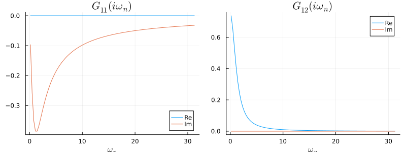
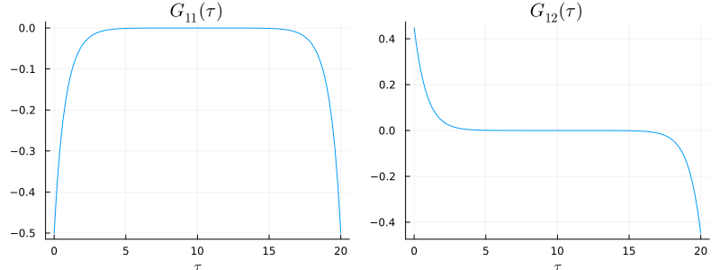

# Usage Example: Hubbard Dimer

This example demonstrates how to use `QMBToolkitED.jl` to calculate the Green's function for a Hubbard dimer at half-filling.

## 1. Define the Model

First, we define the parameters for our model. We'll consider the non-degenerate ground state case where the hopping parameter `t` is significant compared to the on-site interaction `U`.

```@example usage
using QMBToolkitED
t = 1.0  # Hopping strength
U = 2.0  # On-site interaction
beta = 20.0 # Inverse temperature
n_matsubara = 100 # Number of Matsubara frequencies
n_tau = 100 # Number of imaginary time points

# Flavors are defined as:
# 0: atom 1, spin-up
# 1: atom 1, spin-down
# 2: atom 2, spin-up
# 3: atom 2, spin-down
```

## 2. Construct the Hamiltonian

We create the hopping matrix and Coulomb tensor as strings. The model is defined at half-filling by setting the on-site energy to `-U/2`.

```@example usage
hopping_str = """
0 0 $(-U/2) 0.0
1 1 $(-U/2) 0.0
2 2 $(-U/2) 0.0
3 3 $(-U/2) 0.0
0 2 $(-t) 0.0
2 0 $(-t) 0.0
1 3 $(-t) 0.0
3 1 $(-t) 0.0
"""

coulomb_str = """
4
0 0 1 1 0 $(U) 0.0
1 1 0 0 1 $(U) 0.0
2 2 3 3 2 $(U) 0.0
3 3 2 2 3 $(U) 0.0
"""

# Build basis with (N, Sz) conservation
flavor_qns = [QN_NSz(1, 1), QN_NSz(1, -1), QN_NSz(1, 1), QN_NSz(1, -1)]
basis = Basis(flavor_qns)

# Build the Hamiltonian from the string inputs
H, annh = build_hamiltonian(basis, IOBuffer(hopping_str), IOBuffer(coulomb_str));
```

## 3. Solve the System

Next, we diagonalize the Hamiltonian to find its eigenvalues and eigenvectors.

```@example usage
result = solve_hamiltonian(H);
```

## 4. Calculate Green's Functions

With the solution, we can now compute the Green's functions in both Matsubara frequency and imaginary time. We'll calculate the local (diagonal) Green's function `$G_{11}` and the non-local (off-diagonal) Green's function `$G_{12}`.

```@example usage
# Matsubara Green's function G(iωₙ)
iwn, g11_matsubara = calculate_green_matsubara(result, annh[1], annh[1], beta, n_matsubara);
_,   g12_matsubara = calculate_green_matsubara(result, annh[1], annh[3], beta, n_matsubara);

# Imaginary-time Green's function G(τ)
tau_grid, g11_tau = calculate_green_tau(result, annh[1], annh[1], beta, n_tau);
_,        g12_tau = calculate_green_tau(result, annh[1], annh[3], beta, n_tau);
```

## 5. Plot the Results

Finally, we can visualize the results.

### Matsubara Green's Function



### Imaginary-Time Green's Function


